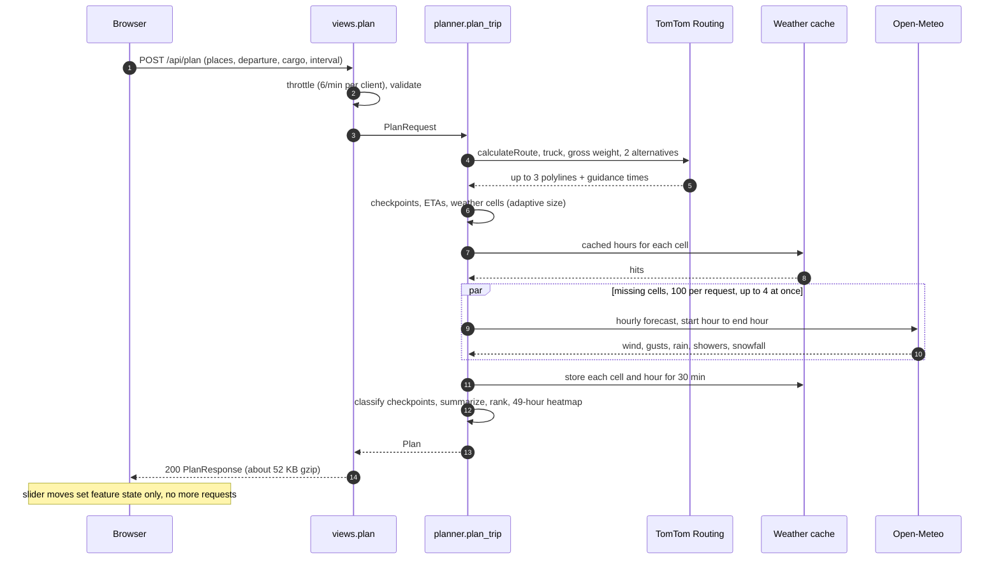
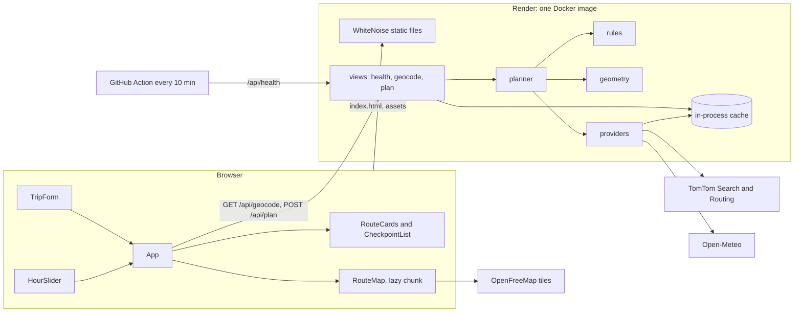
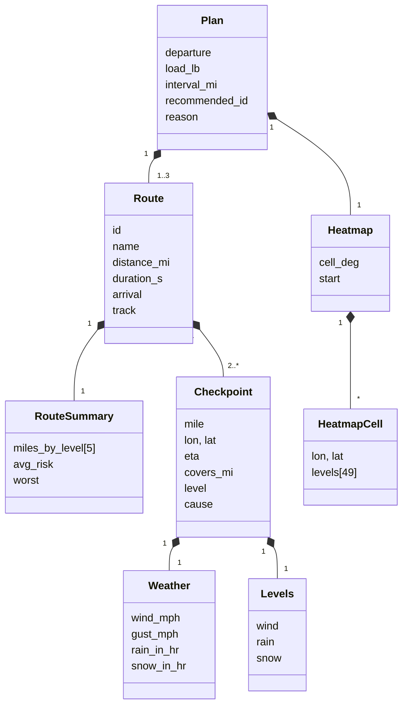

# Corridor: design

How the app turns "Dallas to Chicago, Thursday 06:00, 45,000 lb" into three scored truck routes, a recommendation and a 48-hour corridor heatmap.

Status: implemented, tested in fixture mode and run live against TomTom and Open-Meteo (Dallas to Chicago and three other city pairs on 2026-11-13). Every number below comes from the code or from a measurement, and estimates are marked as such.

## 1. Context

The brief's user is the truck driver planning a run a few hours to a few days ahead. The same screen also serves a dispatcher planning for a driver: the verdict and its reason come first, and the per-checkpoint numbers sit underneath for anyone who wants to check them. Weather along the way changes while the truck drives, so the forecast that matters at mile 600 is the one for the hour the truck gets there, not the one at departure. Spotter's brief gives risk bands for wind, rain and snow, two load rules that make wind worse for heavy trucks, and asks for three route options, checkpoints every 10, 25 or 50 miles, a recommendation and a corridor heatmap with a 0 to 48 hour slider.

### Goals

1. Score each route with the brief's rules at the right hour for every checkpoint, and say plainly why one route wins.
2. Make the map and slider feel instant: one network request per plan, no request and no data rebuild while sliding.
3. Run on free tiers (TomTom, Open-Meteo, Render) without leaking keys or letting one client spend the shared quota.

### Non-goals

- Driver hours of service and rest breaks in this version. ETAs are pure driving time; section 15 states the cost and the plan.
- Live re-routing while a truck is moving, accounts, saved trips, history.
- Routes outside the United States (the rules are in pounds and the brief's examples are US).
- Weather beyond 12 days out (the forecast source stops at about 15 days and the plan needs 48 hours past departure).

## 2. Requirements

| Kind | Requirement | Target | Where it is met |
|---|---|---|---|
| Functional | Up to three truck routes between two US places | 3 when the provider has them | `providers._tomtom_routes` |
| Functional | Checkpoints every 10, 25 or 50 mi plus the destination, each with ETA, weather, levels and cause | Exact, see section 4.2 | `planner.plan_trip` |
| Functional | Risk and load rules exactly as the brief states, edges made explicit | Section 3 | `rules.py` |
| Functional | A recommendation with a reason a driver or dispatcher can check | One sentence naming the deciding numbers | `rules.rank` |
| Functional | Corridor heatmap for hours 0 to 48 with a slider | 49 hours, every cell within 15 mi of any route | `planner`, `RouteMap` |
| Latency | Server time for one plan | Fixture: 85 ms measured. Live Dallas to Chicago: 10.4 s cold, 7.9 s with the weather cached. TomTom's truck routing with two alternatives takes 8.3 to 8.5 s of that; Open-Meteo about 1.2 s for 4 parallel batches | section 6 |
| Payload | Plan response, 25 mi interval, Dallas to Chicago | 216 KB raw, 52 KB gzip (10 mi: 263 / 56 KB; 50 mi: 200 / 51 KB) | GZip middleware |
| Smoothness | Slider move with 4x CPU throttle | 0 source reloads, frame p95 32.6 ms | section 5.6 |
| Quota | Stay inside free tiers | Open-Meteo 600 locations a minute, 10,000 a day; TomTom 2,500 requests a day | section 6 |
| Security | Keys never reach the browser, logs or errors | Server-only env vars, failures logged without URLs | section 9 |

## 3. Rules (the brief, made exact)

### 3.1 Risk levels

`Level` is an ordered enum: `LOW=0, MODERATE=1, HIGH=2, SEVERE=3, NO_TRAVEL=4`. The number is also the score used for average risk.

| Condition | Low | Moderate | High | Severe | No Travel |
|---|---|---|---|---|---|
| Wind (mph, sustained 10 m) | < 25 | 25 to < 35 | 35 to < 45 | 45 to < 55 | ≥ 55 |
| Rain (in/hr, rain + showers) | < 0.10 | 0.10 to < 0.25 | 0.25 to < 0.50 | 0.50 to ≤ 1.00 | > 1.00 |
| Snow (in/hr, snowfall) | < 0.5 | 0.5 to < 1.0 | 1.0 to < 2.0 | 2.0 to ≤ 3.0 | > 3.0 |

The brief's ranges touch at 0.25, 0.50 and so on. A value on a shared edge goes to the higher band. The top edges follow the brief's own "> 1.00" and "> 3.0", so 1.00 in/hr of rain is still Severe. Values are rounded (wind to 0.1 mph, rain and snow to 0.01 in/hr) before they are classified, so the number on screen always matches its level. Tables: `WIND_BANDS`, `RAIN_BANDS`, `SNOW_BANDS` in `rules.py`.

### 3.2 Load rules (raise the wind level, never lower it)

| Wind | Cargo | Wind level becomes |
|---|---|---|
| ≥ 55 mph | any | No Travel (same as the table) |
| 45 to < 55 mph | > 30,000 lb | No Travel |
| 35 to < 45 mph | > 40,000 lb | Severe |

"Over" is strict: 40,000 lb with 40 mph wind stays High, 40,001 lb is Severe. The e2e suite pins this edge. Table: `LOAD_RULES`.

### 3.3 One checkpoint

`level = max(wind, rain, snow)`. `cause` names the condition that set it, with ties going to wind, then snow, then rain, for example "wind 41.0 mph with 45,000 lb load". A Low checkpoint's cause is "no condition above Low", and the UI hides it.

### 3.4 Miles per checkpoint

Checkpoints sit at mile 0, N, 2N, ... and at the destination. Each covers the miles halfway to its neighbours, so the covered miles add up to the route length. With N = 25 on a 60-mile route: mile 0 covers 12.5, mile 25 covers 25, mile 50 covers 17.5, mile 60 covers 5. If the destination is less than 1 mile past the last multiple of N, that checkpoint is dropped so the destination is not doubled.

### 3.5 Ranking and reason

Routes sort by this key, smallest first, and the first is recommended:

1. No Travel miles (the brief's list skips this level; any No Travel mile is worse than any Severe mile)
2. Severe miles
3. High miles
4. Average risk = Σ(level × covered miles) / route miles, rounded to 0.01
5. Travel time

Miles are rounded to 0.1 before comparing. The sort is stable, so a full tie keeps the provider's order (TomTom lists its preferred route first).

The reason compares the winner with each other route on the first key where it wins, lists the most decisive comparison first, and states the time cost when the safer route is slower. If even the winner has Severe or No Travel miles, it ends with a warning. Example from the fixture at 45,000 lb:

> Route B: fewer Severe miles than Route A (0 vs 75), 11 min slower; fewer High miles than Route C (150 vs 375).

## 4. High-level design

```
Browser (React + MapLibre)                Django API (1 process, 8 threads)          Outside services
--------------------------                ---------------------------------          ----------------
type "Dall" ── GET /api/geocode?q= ──▶    throttle ─ cache (1 day) ─ geocode() ──▶   TomTom Search
submit form ── POST /api/plan ───────▶    throttle ─ validate ─ plan_trip()
                                            1. routes()          ──────────────▶     TomTom Routing (truck)
                                            2. checkpoints + ETAs        (pure)
                                            3. weather cells, adaptive size (pure)
                                            4. hourly() ─ cache (30 min) ─────▶     Open-Meteo, batches of 100
                                            5. classify, summarize, rank (pure)
                                            6. heatmap: 49 hours per cell (pure)
cards, map, ◀── PlanResponse (52 KB gzip) ─
heatmap, slider: no further requests
```

- **One request per plan.** `/api/plan` returns routes, checkpoints, the recommendation and the whole 49-hour heatmap. The slider never calls the server.
- **The server owns all keys and all rules.** The browser maps level numbers to names and colours and nothing else.
- **No database.** A plan is computed from live data in about a second. Weather is cached per grid cell and hour in process memory for 30 minutes, which covers repeat and nearby plans.
- **Fixture mode.** `ROUTING_PROVIDER=fixture` serves three recorded Dallas to Chicago routes, and `WEATHER_PROVIDER=fixture` serves a scripted moving storm. The e2e suite runs on both, so it is repeatable and needs no key.
- **One deployable.** One Docker image on Render serves the built React app (WhiteNoise) and the API from one origin, so there is no CORS.

### 4.1 Request sequence for one plan



### 4.2 Components



## 5. Low-level design

### 5.1 Modules

```
backend/
  config/settings.py   env-driven settings: DEBUG, hosts, cache, logging, security headers, throttle switch
  config/urls.py       /api/* routes, index.html for app paths, 404 for missing assets
  trips/domain.py      frozen dataclasses: Place, Weather, Levels, Assessment, RouteOption, Checkpoint,
                       RouteSummary, Route, HeatmapCell, Heatmap, Plan; aliases TrackPoint, Cell, MilesByLevel
  trips/rules.py       WIND/RAIN/SNOW_BANDS, LOAD_RULES, classify(weather, load_lb) -> Assessment,
                       covered_miles(miles, total), summarize(checkpoints, distance_mi), rank(routes)
  trips/geometry.py    haversine, cumulative_miles, point_and_time_at, thin_track, cell_of, corridor_cells
  trips/planner.py     plan_trip(request, providers) -> Plan; forecast_index; adaptive weather cells
  trips/providers.py   TomTom search and routing, Open-Meteo hourly, fixture twins, get_providers()
  trips/views.py       health, geocode, plan: throttle, validate, call planner, map errors to HTTP
  trips/fixtures/      recorded routes (re-record with a script, never by hand)
  scripts/check_fixture.py   asserts the fixture scenarios and the checkpoint/heatmap agreement
frontend/src/
  api.ts               the one TypeScript copy of the contract in 5.3, fetch wrappers
  App.tsx              layout and wiring: shown plan, plan header, lazy map, slider and focus handoff
  usePlanRequest.ts    one plan request at a time: abort the previous one, 30 s timeout, error copy
  PanelStates.tsx      empty, loading, refreshing, error banner and risk legend
  TripForm.tsx         departure, cargo and interval fields; submit and interval rules
  PlacePicker.tsx      place combobox: debounced search (usePlaceSearch), list, keyboard
  tripFormCheck.ts     pure form validation: limits, field messages, first invalid field
  RouteCards.tsx       one card per route: ranking numbers, time, distance, recommended badge and reason
  CheckpointList.tsx   checkpoints of the selected route; a click focuses the map
  HourSlider.tsx       0 to maxHour slider labelled "+12 h, Thu 18:00 CST"
  RouteMap.tsx         react-map-gl wiring, hour updates once per animation frame
  CheckpointPopup.tsx  checkpoint popup: ETA, level, cause, conditions, covered miles
  mapLayers.ts         layer install, plan data, selection, hour, camera
  planGeoJson.ts       plan -> GeoJSON for heat cells, routes, checkpoints, trucks
  basemap.ts           dark OpenFreeMap style, pruned and contrast-tuned at load
  mapHandoff.ts        MapApi: how App talks to the lazily loaded map through a ref
  MapUnavailable.tsx   the one map-failure message
  levels.ts            the only table of level names and colours
  format.ts            times in the browser's zone, durations, distances
e2e/                   Playwright, 8 tests against Django in fixture mode
```

### 5.2 Data model



The same shape as text:

```
Plan ── departure, load_lb, interval_mi, recommended_id, reason
 ├── routes: Route[3]  (ranked, recommended first)
 │     ├── id "A".."C" (provider order, stable across ranking), name, distance_mi, duration_s, arrival
 │     ├── track: [lon, lat, seconds after departure][]   (thinned to ≥ 0.2 mi for the response)
 │     ├── summary: miles_by_level[5], avg_risk, worst
 │     └── checkpoints: Checkpoint[]
 │            mile, lon, lat, eta, covers_mi, weather{wind, gust, rain, snow}, levels{wind, rain, snow},
 │            level, cause
 └── heatmap: cell_deg, start (departure floored to the hour), cells[{lon, lat, levels[49]}]
```

All dataclasses are frozen. A `Route` is built once with its real summary; nothing is mutated after construction.

### 5.3 API contract

All times are ISO 8601 UTC. Coordinates are `[lon, lat]`. Errors are `{ "error": "<plain sentence>" }`.

| Endpoint | Success | Errors |
|---|---|---|
| `GET /api/health` | `200 {"ok": true}` | none |
| `GET /api/geocode?q=dal` | `200 [{label, lon, lat}]`, up to 5, US only; `[]` for under 2 characters | 429 throttle, 502 provider |
| `POST /api/plan` | `200 PlanResponse` | 400 validation, 413 body over 2.5 MB, 422 no route, 429 throttle, 502 provider |
| any other `/api/...` path | none | 404 `{"error": "Not found."}` |

Validation (400): body is a JSON object; origin and destination have a label and valid coordinates and are at least 1 mile apart; departure has a time zone and is between 1 hour ago and 12 days ahead; cargo is a whole number from 1 to 45,000 lb (80,000 lb legal gross minus the 35,000 lb tare added for routing); interval is 10, 25 or 50; `demo`, when present, is a boolean. Messages are user-facing, for example "Cargo weight must be between 1 and 45,000 lb."

```ts
type Level = 0 | 1 | 2 | 3 | 4;              // LOW, MODERATE, HIGH, SEVERE, NO_TRAVEL

interface PlanRequest {
  origin: Place; destination: Place;         // Place = { label: string; lon: number; lat: number }
  departure: string; load_lb: number; interval_mi: 10 | 25 | 50;
  demo?: boolean;                             // true: recorded routes and the scripted storm (5.5)
}

interface PlanResponse {
  departure: string;                          // exactly as requested
  load_lb: number;
  interval_mi: 10 | 25 | 50;
  recommended_id: string;
  reason: string;
  routes: Route[];                            // ranking order
  heatmap: Heatmap;
}

interface Route {
  id: string; name: string; distance_mi: number; duration_s: number; arrival: string;
  track: [number, number, number][];          // [lon, lat, seconds after departure]
  checkpoints: Checkpoint[];
  summary: { miles_by_level: [number, number, number, number, number]; avg_risk: number; worst: Level };
}

interface Checkpoint {
  mile: number; lon: number; lat: number; eta: string; covers_mi: number;
  weather: { wind_mph: number; gust_mph: number; rain_in_hr: number; snow_in_hr: number };
  levels: { wind: Level; rain: Level; snow: Level };
  level: Level;
  cause: string;                              // "no condition above Low" when level is 0
}

interface Heatmap {
  cell_deg: number;                           // 0.25, 0.5 or 1.0 (section 5.4.4)
  start: string;                              // departure floored to the whole UTC hour
  cells: { lon: number; lat: number; levels: Level[] }[];   // levels[h] is start + h hours, h = 0..48
}
```

### 5.4 Plan pipeline (`planner.plan_trip`)

```
options      = providers.routes(origin, destination, departure, load_lb)[:3]      # NoRouteError -> 422
start_hour   = floor_to_hour(departure)
forecast_end = max(start_hour + 48 h, latest arrival + 1 h), rounded up to the hour
for each option (id A, B, C in provider order):
    cumulative = cumulative_miles(full track)
    miles      = checkpoint_miles(total, interval)            # 5.4.1
    points     = [point_and_time_at(track, cumulative, m) for m in miles]   # 5.4.2
    covers     = covered_miles(miles, total)                  # section 3.4
cell_deg, cells = weather_cells(tracks, all checkpoint points) # 5.4.4
hourly          = providers.hourly(cells, start_hour, forecast_end)   # one series per cell
for each checkpoint: weather = hourly[cell_of(point)][forecast_index(eta)]; assessment = classify(weather, load)
for each route: Route(..., track = thin_track(track), summary = summarize(checkpoints, total))
for each cell, h in 0..48: level = classify(hourly[cell][h], load).level
ranked, reason = rank(routes)
```

#### 5.4.1 Checkpoint placement

```
miles = [0]; m = N
while m < total - 1: miles.append(m); m += N
miles.append(total)
```

#### 5.4.2 ETA along a route

TomTom returns the polyline and guidance instructions with `(routeOffsetInMeters, travelTimeInSeconds)`. Offsets are scaled to the polyline's own length, then each polyline point gets a time by linear interpolation between the surrounding instructions, so slow stretches (cities, climbs) get later ETAs than a constant speed would. `point_and_time_at(track, cumulative, mile)` binary-searches the cumulative miles and interpolates position and seconds between two track points. `eta = departure + seconds`. The last point's time equals TomTom's total travel time exactly.

#### 5.4.3 Which forecast hour

```
forecast_index(t) = floor((t - start_hour) / 1 h + 0.5)      # nearest hour, a tie goes to the later hour
```

Python's `round()` rounds halves to even and would map a 12:30 departure to hours 0, 2, 2, 4, 4 and skip every other hour, so it is not used. The heatmap reads index `h` directly for slider hour `h`, because `heatmap.start = start_hour`. The result: a checkpoint shows exactly the level of its cell at the slider hour nearest its ETA. `check_fixture.py` and the e2e suite both assert this for a :30 departure.

#### 5.4.4 Corridor cells and adaptive size

A cell is a square of `cell_deg` degrees, identified by its centre `cell_of(lon, lat) = (round(lon / d) * d, round(lat / d) * d)`. The corridor is every cell that contains a track point, plus every cell whose centre is within max(15 mi, half the cell's diagonal) of one, so coarse cells never leave part of a route uncovered. The longitude search width scales with `1 / cos(latitude)` so no cell is missed in the north. Checkpoint cells the corridor misses are added.

Open-Meteo counts every location against 600 a minute, so a plan must stay well under that:

```
for d in (0.25, 0.5, 1.0):
    cells = corridor(tracks, d) ∪ checkpoint cells
    if len(cells) ≤ 250: return d, cells
return 1.0, cells                                           # provider will report its limit if hit
```

Live cell counts at 0.25° / 0.5° / 1°: Dallas to Chicago 366 / 136 / 64, so it uses 0.5°; Atlanta to Miami 216, Los Angeles to Phoenix 143 and Denver to Salt Lake City 133 stay at 0.25°. The cap is 250 rather than 450 because at 366 cells only one cold plan a minute fits in Open-Meteo's 600, and a second try from a grader would fail.

### 5.5 Providers

| Call | Request | Notes |
|---|---|---|
| TomTom routing | `travelMode=truck`, `vehicleCommercial=true`, `vehicleWeight` = (cargo + 35,000 lb) in kg, `maxAlternatives=2`, `alternativeType=anyRoute`, `departAt` = max(departure, now + 1 min), `traffic=false`, `instructionsType=coded`. Live traffic made TomTom return only 1 route for some departures (Dallas to Chicago at 09:30 UTC: 1 with traffic, 3 without); historical speeds for the departure hour still shape the ETAs | a 400 whose error code means no route (`NO_ROUTE_FOUND`, `MAP_MATCHING_FAILURE`, `CANNOT_RESTORE_BASEROUTE`) is `NoRouteError`, 422; any other 400 is our own bad request, 502 |
| TomTom search | `countrySet=US`, `typeahead=true`, `limit=5`, `idxSet=Geo,PAD` | cached 1 day per query |
| Open-Meteo | `hourly=wind_speed_10m,wind_gusts_10m,rain,showers,snowfall`, mph and inch, GMT, `start_hour`/`end_hour`, 100 locations per request, up to 4 requests in parallel | a null takes the nearest valid hour within 3 hours, otherwise the plan fails; a series that does not cover the requested hours is an error, never padded; concurrent plans share in-flight fetches per cell |

Route names are the two roads with the most distance on the route, made distinct across the three routes.

**Storm demo.** A plan with `demo: true` uses the fixture providers whatever the environment says: the three recorded Dallas to Chicago routes and the scripted storm field, which moves with the forecast hour, so it looks the same on any date. Live weather is often calm along a whole corridor, which leaves every checkpoint Low and hides the rules. The demo lets a reviewer see the load rule change the pick (Route A at 20,000 lb, Route B at 45,000 lb) on any day. The UI labels it as not live weather, and its load toggle replans only the demo.

### 5.6 Front end rendering

- Dark theme only, OpenFreeMap's dark style with buildings, land use, minor roads and rail removed at load, and labels lifted for contrast.
- The map code is a separate chunk loaded with `React.lazy`, so the form paints before MapLibre (about 300 KB gzip plus a 148 KB gzip worker) arrives. Main bundle: about 52 KB gzip. Hashed assets are served as immutable.
- Layers, bottom to top, all under the basemap labels: heat cells (fill), route lines (others grey, selected blue and wider), checkpoint circles coloured by level, trucks.
- **Slider path.** GeoJSON for a plan is built once. Each heat cell has a numeric feature id, and `fill-color` reads `["feature-state", "level"]` (transparent when unset). A slider move, coalesced to one per animation frame, sets one feature state per cell and replaces the three-point truck source. It never changes the style. A data-driven paint expression (`match` on `r{h}`) was the first version; MapLibre reloads the source on every change of such a property (1 reload and 6 `sourcedata` events per move). `global-state` was tried and rejected because combined with per-cell data it still reloads. Measured with a 4x CPU throttle on 279 cells (fixture at 0.25°, before the cap went to 250): 0 reloads per move, frame p50 30.3 ms and p95 32.6 ms (was 30.6 and 34.3), feature-state writes 0.1 ms p95.
- Trucks show each route's position at `heatmap.start + h hours`: at the origin before departure, hidden after arrival.
- App keeps the current slider hour and any checkpoint focus made before the map finished loading in two refs the map reads when it loads. A new plan resets the hour to 0 and drops a pending focus. The open checkpoint lives in App's shown plan, so the popup and the marked list row always agree; a new plan, a route click or closing the popup clears it.
- Level colours come from `levels.ts` only and match across map, cards, list and legend. Times show in the browser's time zone with its abbreviation.
- Failures: a missing WebGL context, a failed map chunk or a failed basemap style all show one message, and the form and cards keep working.

## 6. Capacity and quotas

| Resource | Free limit | Cost per plan | Plans before the limit |
|---|---|---|---|
| Open-Meteo, per minute | 600 locations | 136 (live Dallas to Chicago at 0.5°, cold cache); at most 250 | 4 a minute (2 at the cap) |
| Open-Meteo, per hour | 5,000 locations | 136 | about 36 an hour |
| Open-Meteo, per day | 10,000 locations | 136 | about 73 a day cold; repeats within 30 min are free |
| TomTom, per day | 2,500 requests | 1 routing + about 10 search keystrokes (debounced, cached a day) | about 225 a day |
| Render free instance | 512 MB, 0.1 CPU | about 85 ms CPU per plan in fixture mode | not the bottleneck |

Open-Meteo is the binding limit, about 3x tighter than TomTom. Our own throttle (6 plans a minute per client) bounds what one client can spend, but it does not guarantee the weather budget: three cold plans at the 250-cell cap in one minute pass 600 locations, and the third then fails with "The weather service is busy right now. Try again in a minute." Repeat and nearby plans are served from the cache. A live run hit exactly this with the earlier 450 cap: the second cold Dallas to Chicago plan in a minute got a 429. Section 14 covers the fix at scale. The weather cache holds at most 12,500 entries per plan (250 cells x 50 hours).

## 7. Failure modes

| Failure | Detection | Behaviour | What the user sees |
|---|---|---|---|
| TomTom has no route (HTTP 400 with a no-route code) | status and error code | 422 | "No truck route was found between these places." |
| TomTom rejects our request (other HTTP 400) | status and error code | 502, logged | "The TomTom routing service rejected the request." |
| TomTom or Open-Meteo down, 5xx or timeout (15 s) | exception | 502, logged with service, status, elapsed | "The ... service is unavailable right now." |
| Provider rate limit (429) | status code | 502, logged | "The ... service is over its request limit. Try again later." |
| Open-Meteo returns nulls | parse | nearest valid hour within 3 h used; a longer gap or an all-null scored series is a 502 | normal plan, or "returned incomplete data" |
| Open-Meteo returns the wrong hours | parse | 502, nothing cached | "returned an unexpected response" |
| Our throttle hit | cache counter | 429 with `Retry-After: 60` | "Too many requests. Wait a minute and try again." |
| Bad input | validation | 400 | field message in the form; server message as a fallback |
| Plan takes over 30 s | browser timeout | request aborted | "Planning took too long. Try again." with the form still usable |
| A newer plan is requested | browser | older request aborted, its result ignored | only the newest plan shows |
| Replan fails after a good plan | browser | old results stay | banner says the results below are from the previous plan |
| WebGL missing, map chunk or basemap fails | map events, error boundary | map replaced by a message | routes and checkpoints still listed |

## 8. Caching and concurrency

- Gunicorn runs one process with 8 threads. One process means one in-memory cache, so a repeat plan always finds its weather (two processes would miss about half the time).
- Weather: key `weather:{lon:.2f}:{lat:.2f}:{UTC hour}`, TTL 30 minutes. A plan reads its cells and hours from the cache and fetches only the missing cells, in batches of 100 with up to 4 in parallel. Django's local-memory cache is thread-safe.
- Geocode: key by lower-cased query, TTL 1 day.
- Throttle counters: `throttle:{scope}:{client}`, 60-second window.
- Nothing is invalidated by hand. Forecasts change hourly at most, so 30 minutes bounds staleness.

## 9. Security and abuse

- `TOMTOM_API_KEY` lives only in the server's environment (`backend/.env` locally, ignored by git; a Render secret in production). The browser never sees it.
- Provider failures are logged as service, status and elapsed time, and re-raised without the original exception chained, so a request URL containing `?key=` can never reach a log or a traceback.
- Per-client throttles: `/api/plan` 6 a minute, `/api/geocode` 60 a minute. The client is the first `X-Forwarded-For` entry behind Render's proxy. That header can be forged, so this is a cost guard, not a security boundary.
- Input: JSON object only, strict types, ranges in 5.3, query length capped at 100 characters, deeply nested JSON rejected.
- Headers: HSTS (no preload), `X-Content-Type-Options: nosniff`, `Referrer-Policy: same-origin`, `X-Frame-Options: DENY`. There are no cookies or sessions, so CSRF protection does not apply.
- The container runs as a non-root user.

## 10. Observability

- Logs go to stdout and Render's log stream. Each plan logs `routes`, `cells`, `cell_deg` and `elapsed_ms`, without places. Each provider failure logs service, HTTP status and elapsed time. Gunicorn writes an access log.
- What we would alert on with a log-based monitor: provider error rate over 5% in 10 minutes, any Open-Meteo 429, plan p95 over 5 s, and the keep-warm ping failing.
- `/api/health` is the Render health check and the keep-warm target.

## 11. Deployment and rollback

- One Docker image: Node 22 builds the front end, Python 3.13 with uv installs locked dependencies, Gunicorn serves Django, WhiteNoise serves the built files.
- Render builds from `render.yaml` on push to `main`, checks `/api/health`, and only then switches traffic.
- Rollback: redeploy the previous successful deploy from Render's dashboard. There is no database or migration, so rollback is always safe.
- A GitHub Action pings `/api/health` every 10 minutes so the free instance does not sleep.

## 12. Testing

| Layer | What | Command |
|---|---|---|
| Static | ruff, ty (Python types), tsc strict | see AGENTS.md |
| Rules on real fixtures | `check_fixture.py`: expected recommendations at 20,000 and 45,000 lb, covered miles add up, every checkpoint matches its heatmap cell | `uv run python scripts/check_fixture.py` |
| End to end, UI | three routes and one recommendation; a heavier load changes it; interval spacing and ETA order; slider repaints with no request; past departure shows a field message | `cd e2e && npm test` |
| End to end, API | interval validation; the 40,000 vs 40,001 lb load edge with the exact reason; checkpoint placement, coverage and heatmap agreement for a :30 departure | same |
| Performance | slider sweep and plan-to-idle under 4x CPU throttle | Playwright scripts, run by hand |

There are no unit tests by choice: the e2e suite runs the real rules on recorded routes and a scripted storm, so a wrong band edge, a wrong ranking or a miscounted mile fails a test.

## 13. Alternatives considered

| Decision | Chosen | Rejected | Why |
|---|---|---|---|
| Heatmap shape | Grid of cells in one GeoJSON source | Raster or vector tiles per hour | At most 250 cells is tiny; tiles need a tile server and a request per hour |
| Heatmap delivery | All 49 hours in the plan response | Fetch each hour as the slider moves | Sliding must not wait on the network; 49 levels per cell gzip to almost nothing |
| Slider repaint | Feature state per cell | Data-driven paint per hour; 49 layers toggled; `global-state` | The first reloads the source on every move; 49 layers cost 49x buckets; global-state cannot index per-cell data without a reload |
| Routing | TomTom (truck profile, weight, traffic-aware times, alternatives) | OSRM (no truck profile), Google (no truck routing), HERE (similar, smaller free tier) | Truck weight changes the route and the times |
| Weather | Open-Meteo (free, batch of 100 locations, hourly to 16 days) | NWS (US only, one gridpoint per call, no batch), Tomorrow.io (key, low free limits) | One request covers 100 cells |
| Storage | None, in-process cache | Postgres or Redis | Every plan is computed from live data; nothing needs to persist; one process |
| Hosting | Render, one Docker image | A VM | No server to patch; health checks and rollback built in |
| Corridor size control | Adaptive cell size | Fixed size with a trip length cap | Long trips still work, with a coarser heatmap |

## 14. Scaling path (100x traffic)

1. Weather becomes the cost: move the cache to Redis shared by all instances, keyed the same way, and pay for Open-Meteo or self-host it (it is open source).
2. Past a few hundred plans an hour, fetch the whole US grid once an hour in a background job (about 25,000 cells at 0.25°) and stop calling the weather API per request. Plans then read only from Redis.
3. Run several web instances behind the load balancer; nothing in a request depends on local state once the cache is shared. Move the throttle to Redis as well.
4. Serve static assets from a CDN; ship heatmap cells as a compact array instead of GeoJSON-shaped objects (they are already a small part of the payload; tracks are the largest part).
5. TomTom then needs a paid plan; route results can be cached for a few minutes per origin, destination, weight bucket and departure hour.

## 15. Assumptions, risks and open questions

Assumptions:

1. ETAs use TomTom truck travel times and ignore hours of service. This costs accuracy, not legality checks: the app never claims a schedule is legal, but it scores late checkpoints at the wrong hour. US rules allow 11 hours of driving, then a 10-hour break (plus a 30-minute break after 8 hours). On fixture Route A (964 mi, 17 h 05 min of driving) the truck reaches about mile 635 at hour 11 (measured from the plan's ETAs), so every checkpoint on the last 330 or so miles is really reached about 10 hours later than shown, and is scored with a forecast 10 hours too early. Next steps, in order: (a) apply the 11 h driving and 10 h break rule by default, shifting ETAs after hour 11 and moving the heatmap trucks to match; (b) let the driver enter a planned stop (place and length) instead; (c) read the driver's remaining hours from their ELD so the clock starts where they actually are. (a) is a change to ETA interpolation in the planner plus one e2e test; it was left out to keep the brief's scope and the deadline.
2. Wind means sustained wind at 10 m. Gusts are shown but not scored.
3. Weather comes from the forecast hour nearest each ETA.
4. Heatmap hour 0 is the departure's whole hour (12:00 for a 12:30 departure), so every slider step is a real forecast hour.
5. TomTom routes for gross weight = cargo + 35,000 lb (a typical empty tractor-trailer). The risk rules use cargo alone, as the brief states them.
6. Routes are US only.

Risks:

- The fixture routes were recorded from OSRM before the TomTom key existed, so the fixture's distances (964.2 mi) are measured on a thinned recording and run slightly short of live TomTom (1,045 mi for Route A).
- Open-Meteo's free tier is for non-commercial use. A commercial launch needs its paid plan.
- The throttle trusts `X-Forwarded-For`, which a client can forge.

Open questions for Spotter:

- Should hours of service shift ETAs by default (assumption 1), or should drivers always enter their own planned stops?
- Should gusts count, for example a gust rule for high-sided empty trailers?
- Is "fewest No Travel miles first" the right reading of the brief's ranking list, which does not mention No Travel?
