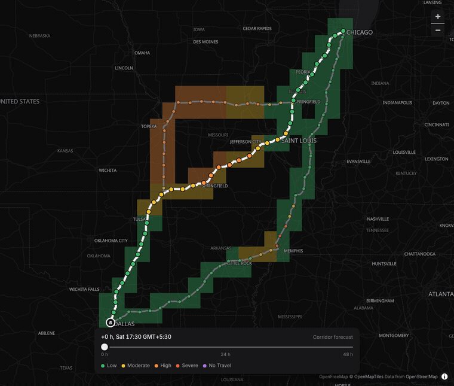

# Corridor: weather-aware truck routing

[](https://github.com/udit19199/corridor-truck-routing/actions/workflows/ci.yml)

A driver enters an origin, a destination, a departure time and a load weight. The app returns three truck routes, checks the forecast at every checkpoint for the hour the truck will reach it, scores each checkpoint with Spotter's risk and load rules, and recommends the safest route. A 0 to 48 hour slider plays the forecast along the whole corridor.

**Live app: https://corridor-truck-routing.onrender.com**

It runs on Render's free plan. If nobody has used it for 15 minutes, the first load shows Render's "waking up" page for up to a minute, and the first plan takes 5 to 15 seconds.


## Try it in one minute

1. Open the live app and click **Run the storm demo**. It plans recorded Dallas to Chicago routes under a scripted storm, because real weather is often calm and then every route is green.
2. At 45,000 lb Route B is recommended. Switch the demo to **20,000 lb**: the 35 to 44 mph wind on Route A drops from Severe to High, and Route A wins. The reason under the top card says why.
3. Drag the forecast slider. The heatmap and the truck markers move hour by hour with no network request.
4. Click any checkpoint, on the map or in the list, for its ETA, the miles it covers, and its wind, rain and snow with a level for each.
5. Then plan any two US cities with live TomTom routes and Open-Meteo weather.



## What the brief asks for, and where to see it

| Requirement | Where it is |
|---|---|
| Origin, destination, departure time, load | The form. Place names autocomplete from TomTom Search, US only |
| 3 route options from a routing API | TomTom truck routing for the truck's gross weight, 3 cards and 3 lines on the map |
| Weather every 10, 25 or 50 miles at the truck's ETA | The Checkpoints buttons. Each checkpoint uses the forecast hour nearest its ETA |
| Risk and load rules | [`backend/trips/rules.py`](backend/trips/rules.py), the only copy. Every checkpoint shows its level per condition |
| Recommend the best route on risk and travel time | The Recommended card and its reason, ranked by Severe miles, High miles, average risk, then travel time |
| Routes, checkpoints, risk, ETAs, summaries on a map | Route lines, checkpoint dots coloured by risk with popups, route cards with miles by level |
| Corridor heatmap with a 0 to 48 h slider | The coloured grid along the routes and the slider under the map |

## How it works

1. **Routes.** TomTom's truck routing returns up to three routes for the truck's gross weight (cargo plus 35,000 lb for the empty truck).
2. **Checkpoints.** A checkpoint every 10, 25 or 50 miles (your pick), plus the destination. Each checkpoint's ETA comes from TomTom's travel times along the route.
3. **Weather.** Open-Meteo's hourly forecast at each checkpoint, for the hour nearest its ETA.
4. **Risk.** Wind, rain and snow each get a level from the brief's table. The load rules can raise the wind level. The checkpoint takes the worst of the three.
5. **Recommendation.** Routes are ranked by No Travel miles, then Severe miles, High miles, average risk and travel time. The reason shown says why the winner beats each other route.
6. **Heatmap.** The same rules run for every grid cell within 15 miles of any route, for each hour from 0 to 48 after the departure's whole hour. Cells are 0.25° and grow to 0.5° or 1° on long trips to stay inside the weather API's limit. The server sends all 49 hours at once, so moving the slider only repaints the map.

[`DESIGN.md`](DESIGN.md) is the full design: requirements, exact rules, pipeline, API contract, quotas, failure modes and the alternatives considered.

## Key decisions and trade-offs

- **One request returns everything, including all 49 heatmap hours.** The slider then never waits on the network. A move sets one feature state per heat cell instead of rebuilding the map source, so it holds 60 fps (measured: p95 frame time 16.7 ms while dragging on the live app).
- **TomTom for routing, Open-Meteo for weather.** TomTom has a real truck profile, so the load changes the route and the times. Open-Meteo takes 100 locations per request, so a whole corridor costs a few calls. Both have free tiers. The server caches weather per cell and hour for 30 minutes, so repeat plans are cheap.
- **No database.** Every plan is computed from live data and nothing needs to persist. One Gunicorn worker owns an in-memory cache; Redis is the first step past one instance (see `DESIGN.md` section 14).
- **The rules live in one place.** Thresholds and load rules exist only in `rules.py`. The API sends levels as numbers, and the front end maps numbers to names and colours in one file.
- **End-to-end tests instead of unit tests.** Playwright drives the real UI against recorded routes and the scripted storm, so a wrong band edge, ranking or mile count fails a test that a user would also notice.
- **Free hosting.** The cost is the cold start and a slow CPU (a tenth of a core). A paid instance would remove both.

## Assumptions

The brief leaves these open. Each choice is written into `backend/trips/rules.py` and `DESIGN.md`.

- When wind, rain and snow hit different levels, the checkpoint takes the worst one.
- A value on a shared edge (0.25 in/hr rain, 1.0 in/hr snow) goes to the higher band. The top edges follow the brief's "> 1.00" and "> 3.0".
- Any No Travel mile ranks a route below every route without one.
- Each checkpoint counts for the miles halfway to its neighbours.
- Wind means the sustained 10 m speed. Gusts are shown but not scored.
- ETAs are pure driving time: they ignore the 11-hour driving limit and the 10-hour break. On a 17-hour run, that means the last few hundred miles are scored with a forecast about 10 hours too early. `DESIGN.md` section 15 describes the fix.
- Heatmap hour 0 is the departure's whole hour (12:00 for a 12:30 departure), not the current time.
- Departures can be up to 12 days ahead; the forecast runs out after that.
- The form asks for cargo weight. TomTom gets cargo plus 35,000 lb for the empty truck; the risk rules use cargo alone, as the brief writes them.

## What I would do next

1. **Hours of service.** Apply the 11-hour driving and 10-hour break rule to ETAs by default, then let the driver enter planned stops. This is the biggest accuracy gap on long trips.
2. **Times in the route's own time zone.** Times now show in the viewer's time zone, which is right for a dispatcher but odd for a driver crossing zones.
3. **Gusts for empty trailers.** High-sided empty trailers are most at risk from gusts, which are shown but not scored today.
4. **Shared cache and more instances.** Move the weather cache and throttle to Redis, then fetch the US grid hourly in the background so plans stop calling the weather API (see `DESIGN.md` section 14).
5. **A paid instance** so the app never sleeps and plans run on more CPU.

## Run it locally

Needs Python 3.13+ with [uv](https://docs.astral.sh/uv/) and Node 22+.

```sh
# Backend (no keys needed in fixture mode)
cd backend
uv sync
ROUTING_PROVIDER=fixture WEATHER_PROVIDER=fixture DEBUG=true uv run python manage.py runserver 8000

# Frontend, in a second terminal
cd frontend
npm ci
npm run dev        # http://localhost:5173
```

For real routes, put `TOMTOM_API_KEY=...` in `backend/.env` (ignored by git) or your shell, and drop the two `*_PROVIDER` variables. Open-Meteo needs no key.

Fixture mode serves three recorded Dallas to Chicago routes and the scripted storm. Search for "Dallas" and "Chicago". Up to 40,000 lb Route A wins; from 40,001 lb the 35 to 44 mph wind on Route A becomes Severe and Route B wins. The storm demo button uses the same data in any mode.

## Tests

End-to-end tests drive the real UI in Chromium against Django in fixture mode:

```sh
cd e2e
npm ci
npx playwright install chromium
npm test
```

They cover the recommendation, the load rule flipping it at exactly 40,001 lb, the storm demo, checkpoint placement and coverage, checkpoints matching the heatmap at their hour, ETA order, the slider repainting with no network request, and input validation.

## CI and deploys

Every push and pull request runs [`ci.yml`](.github/workflows/ci.yml):

| Job | What it checks |
|---|---|
| Workflows | actionlint and zizmor on the workflow files |
| Backend | ruff lint and format, ty type check, Django system checks, the fixture pipeline script |
| Frontend | `tsc` and the production build |
| End-to-end | the Playwright suite above, in fixture mode; traces are uploaded when it fails |
| Docker image | builds the image Render runs, starts it, and checks health, the served page and the non-root user |

Render deploys `main` only after all of these pass (`autoDeployTrigger: checksPass` in `render.yaml`), so a red build never reaches the live app. Actions are pinned to commit SHAs, jobs get a read-only token, and Dependabot sends one grouped minor and patch update PR per ecosystem each month, skipping releases younger than a week.

## Stack

Django 5.2 (plain JSON views, no database), React 18 + TypeScript + Vite, MapLibre GL with OpenFreeMap tiles, TomTom Routing and Search, Open-Meteo. Hosted on Render as one Docker image; Django serves the built front end.

## How this was built

I built this by directing AI coding agents, and I own the result, good and bad. I wrote the plan and the design first (`DESIGN.md`), split the work into pieces for separate agents, and reviewed their output in rounds with independent reviewer agents. I decided the open questions in the brief, chose what to fix and what to leave, and checked each change with the tests and in the browser before committing it. The commit history shows the order: design, then the core, then review and fix rounds.
