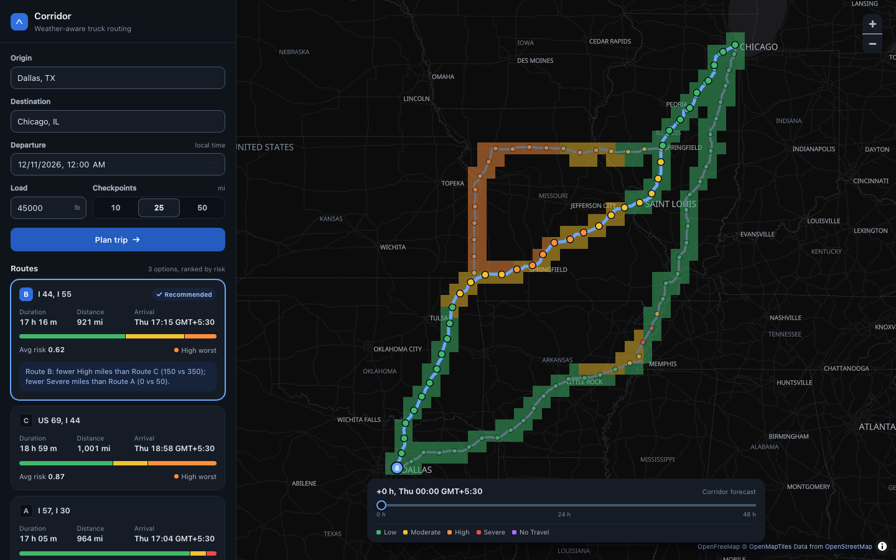

# Corridor: weather-aware truck routing

A driver enters an origin, a destination, a departure time and a load weight. The app returns three truck routes, checks the forecast at every checkpoint for the hour the truck will reach it, scores each checkpoint with Spotter's risk and load rules, and recommends the safest route. A 0–48 hour slider plays the forecast along the whole corridor.

Live app: _added after deploy_



## How it works

1. **Routes.** TomTom's truck routing returns up to three routes. The load weight is sent as the vehicle weight.
2. **Checkpoints.** A checkpoint every 10, 25 or 50 miles (your pick), plus the destination. Each checkpoint's ETA comes from TomTom's travel times along the route.
3. **Weather.** Open-Meteo's hourly forecast at each checkpoint, for the hour nearest its ETA.
4. **Risk.** Wind, rain and snow each get a level from the brief's table. The load rules can raise the wind level. The checkpoint takes the worst of the three.
5. **Recommendation.** Routes are ranked by No Travel miles, then Severe miles, High miles, average risk and travel time. The reason shown says why the winner beats each other route.
6. **Heatmap.** The same rules run for every 0.25° cell within 15 miles of any route, for each hour from 0 to 48 after departure. The server sends all 49 hours at once, so moving the slider only repaints the map.

`DESIGN.md` has the exact thresholds, edge cases, API contract and module map.

## Assumptions

The brief leaves these open. Each choice is written into `backend/trips/rules.py` and `DESIGN.md`.

- When wind, rain and snow hit different levels, the checkpoint takes the worst one.
- A value on a shared edge (0.25 in/hr rain, 35 mph wind) goes to the higher band. The top edges follow the brief's "> 1.00" and "> 3.0".
- Any No Travel mile ranks a route below every route without one.
- Each checkpoint counts for the miles halfway to its neighbours.
- Wind means the sustained 10 m speed. Gusts are shown but not scored.
- ETAs use TomTom truck travel times and do not include driver rest breaks.
- Heatmap hour 0 is the departure time, not the current time.
- The form asks for cargo weight. TomTom gets cargo plus 35,000 lb for the empty truck; the risk rules use cargo alone, as the brief writes them.

## Run it locally

Needs Python 3.13+ with [uv](https://docs.astral.sh/uv/) and Node 22+.

```sh
# Backend (no keys needed in fixture mode)
cd backend
uv sync
ROUTING_PROVIDER=fixture WEATHER_PROVIDER=fixture DEBUG=true uv run python manage.py runserver 8000

# Frontend, in a second terminal
cd frontend
npm ci
npm run dev        # http://localhost:5173
```

For real routes, put `TOMTOM_API_KEY=...` in your shell and drop the two `*_PROVIDER` variables. Open-Meteo needs no key.

Fixture mode serves three recorded Dallas to Chicago routes and a scripted, moving storm. Search for "Dallas" and "Chicago". With 20,000 lb Route A wins; with 45,000 lb the 38 mph wind on Route A becomes Severe and Route B wins.

## Tests

End-to-end tests drive the real UI in Chromium against Django in fixture mode:

```sh
cd e2e
npm ci
npx playwright install chromium
npm test
```

They cover the recommendation, the load rule changing it, checkpoint spacing and ETA order, the slider repainting with no network request, and input validation.

## Stack

Django 5.2 (plain JSON views, no database), React 18 + TypeScript + Vite, MapLibre GL with OpenFreeMap tiles, TomTom Routing and Search, Open-Meteo. Hosted on Render as one Docker image; Django serves the built front end.
